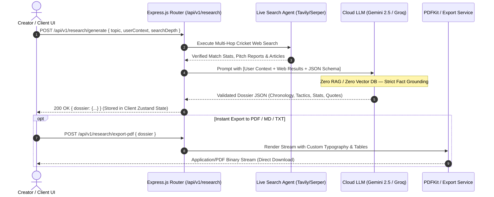
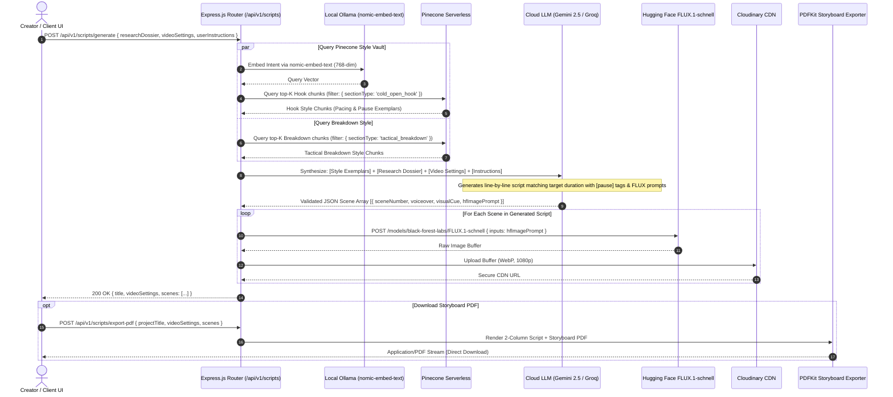
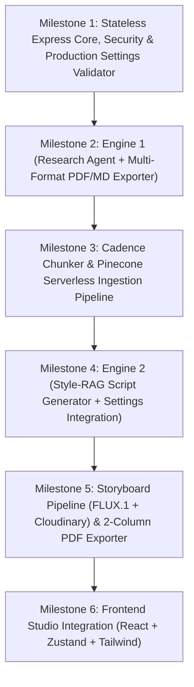

# Product Requirements Document (PRD) & Technical Architecture Blueprint

**Project Name:** CricScript AI — Agentic Cricket Research & Personal Cadence-RAG Scriptwriting Studio  
**Document Version:** 2.0.0-STATELESS  
**Author:** Principal AI Systems Architect & Senior MERN/GenAI Engineer  
**Status:** Approved for Implementation  
**Last Updated:** October 2026  

---

## 1. Executive Summary & System Architecture

### 1.1 Problem Statement & Architectural Pivot
Modern generative AI platforms (ChatGPT, Claude, Gemini) default to generic, expository, and academic prose when tasked with sports commentary. They lack the breath pacing, dramatic staccato pauses, and narrative timing required by professional cricket voiceover artists and documentary filmmakers.

In **CricScript AI v2.0**, we eliminate the unnecessary baggage of traditional multi-tenant SaaS (no user authentication, no database bloat). The application is engineered as a **Stateless, Utility-First Creator Studio**:
1. **Zero-Friction Access (No Authentication):** Creators can immediately research topics, upload reference style scripts, and generate production scripts without registration, login barriers, or session tokens.
2. **Lean, Single-Database Footprint (Pinecone Serverless Only):** The backend does **not** persist research dossiers or generated scripts in MongoDB or SQL. Generated outputs are ephemeral and streamed directly back to the client, where users can download them on demand as formatted **PDF**, **Markdown**, or **TXT** files.
3. **Decoupled Style-Vault Vector Store:** Pinecone Serverless is the **sole persistent database** in the entire system. It acts exclusively as a high-dimensional semantic style vault storing 768-dimensional cadence chunks derived from 100–120 reference cricket scripts.
4. **Dynamic Video Production Settings System:** Creators configure target video format (e.g., YouTube Deep-Dive, Short-form/Reels, Tactical Analysis), target duration, pacing, and narrative structure before generation.

---

### 1.2 System Architecture Overview

```
                                      ┌─────────────────────────────────────────────────────────┐
                                      │                      CLIENT LAYER                       │
                                      │        React 18 + Vite + Tailwind CSS + Zustand         │
                                      │                                                         │
                                      │  - Video Settings Panel (Format, Length, Script Type)  │
                                      │  - Research Dossier Viewer & PDF/MD Exporter            │
                                      │  - Teleprompter Script View with [pause] Highlights     │
                                      │  - Visual Storyboard Gallery (FLUX.1-schnell frames)    │
                                      └────────────────────────────┬────────────────────────────┘
                                                                   │ HTTP / REST (Stateless Payloads)
                                                                   ▼
┌────────────────────────────────────────────────────────────────────────────────────────────────────────────────────────────────────────┐
│                                                   EXPRESS.JS STATELESS SERVICE LAYER                                                   │
│                                                                                                                                        │
│  [CORS: Open/Configured] ─── [Helmet Security] ─── [Joi Payload Validators] ─── [Central Error Handler]                              │
│                                                                                                                                        │
│  ┌────────────────────────────────────────────────────────────────┐  ┌──────────────────────────────────────────────────────────────┐  │
│  │               ENGINE 1: DEEP RESEARCH PIPELINE                 │  │             ENGINE 2: CADENCE-RAG & STORYBOARD               │  │
│  │                                                                │  │                                                              │  │
│  │  Topic + User Context Notes                                    │  │  In-Memory Research Dossier + Video Settings + Directorial   │  │
│  │       │                                                        │  │       │                                                      │  │
│  │       ▼                                                        │  │       ▼                                                      │  │
│  │  Tavily / Serper Search API                                    │  │  Pinecone Vector Query ($match: sectionType)                 │  │
│  │       │ (Multi-hop live match & historical data)               │  │       │ (Cosine Similarity on 768-dim style chunks)          │  │
│  │       ▼                                                        │  │       ▼                                                      │  │
│  │  Cloud LLM Synthesis (Gemini 2.5 / Groq)                       │  │  Cloud LLM Script Generator (Gemini 2.5 / Groq)                  │  │
│  │       │ (Strict grounding, zero RAG/Pinecone)                  │  │       │ (Enforces cadence + line breaks + visual cues)       │  │
│  │       ▼                                                        │  │       ├─────────────────────────┐                            │  │
│  │  Ephemeral JSON Dossier Output                                 │  │       ▼                         ▼                            │  │
│  │       │                                                        │  │  Structured Script   Hugging Face FLUX.1-schnell             │  │
│  │       ▼                                                        │  │  (Pauses & Cues)                │                            │  │
│  │  PDFKit Streaming Exporter (PDF / MD / TXT)                    │  │                                 ▼                            │  │
│  │                                                                │  │                         Cloudinary CDN (WebP)                │  │
│  └────────────────────────────────────────────────────────────────┘  └──────────────────────────────┬───────────────────────────────┘  │
└─────────────────────────────────────────────────────────────────────────────────────────────────────┼──────────────────────────────────┘
                                                                                                      │
                                                                                                      ▼
                                                                                   ┌──────────────────────────────────┐
                                                                                   │       PINECONE SERVERLESS        │
                                                                                   │    (Sole Persistent Database)    │
                                                                                   ├──────────────────────────────────┤
                                                                                   │ - Index: `cricscript-style-vault`│
                                                                                   │ - Dim: 768 (`nomic-embed-text`)  │
                                                                                   │ - Metric: Cosine                 │
                                                                                   │ - Stores author's 100-120 past   │
                                                                                   │   cricket scripts broken into    │
                                                                                   │   cadence & pause chunks         │
                                                                                   └──────────────────────────────────┘
```

---

### 1.3 Data-Flow Architecture Diagrams

#### Engine 1: Deep Research & Instant Document Export


#### Engine 2: Cadence-RAG, Video Settings & Storyboard Pipeline


---

## 2. Complete Tech Stack Specification (Laptop-Friendly)

| Layer | Technology | Version | Rationale & Trade-off Analysis |
| :--- | :--- | :--- | :--- |
| **Frontend Framework** | React + Vite | React 18.3, Vite 5.x | Ultra-fast local development, instant HMR, zero build overhead. |
| **Styling & Icons** | Tailwind CSS + Lucide Icons | Tailwind 3.4+ | Utility-first styling for dark-mode studio teleprompters, dials, and storyboard galleries. |
| **Client State** | Zustand | 4.5+ | Ephemeral in-memory state manager. Holds the active research dossier, video settings, and storyboard scenes without local storage or database sync. |
| **HTTP Client** | Axios | 1.7+ | Clean REST client configured for streaming binary downloads (PDF/MD) and JSON payloads. |
| **Backend Runtime** | Node.js | v22.x LTS | High-throughput asynchronous I/O with native `fetch` and ES Modules. |
| **Web Server Framework**| Express.js | 4.21+ | Lightweight, unopinionated REST API. No database ORM or auth overhead. Fully verifiable via Postman. |
| **Vector DB (Sole DB)**| Pinecone Serverless | `@pinecone-database/pinecone` 3.x | Zero local RAM footprint, serverless AWS `us-east-1` deployment. Dedicated strictly to indexing the 100–120 reference scripts. |
| **Local Embeddings** | Ollama (`nomic-embed-text`) | Ollama 0.3+ | 768 dimensions, 8192 token context. Runs locally on CPU/iGPU in ~15ms per chunk with 0 token costs. |
| **Cloud LLM** | Google Gemini 2.5 Flash / Groq Llama-3.3-70B | Cloud REST APIs | High context capacity (1M+ tokens) for deep dossiers, ultra-fast generation (250+ tok/s on Groq), zero local GPU strain. |
| **Web Research API** | Tavily Search API / Serper.dev | REST v1 | Clean, LLM-optimized search results. Returns scraped markdown summaries and verified factual tables instead of raw HTML. |
| **Image Generation** | Hugging Face Inference API (`FLUX.1-schnell`) | REST API | SOTA cinematic framing and photo-realism for cricket storyboards without running local Stable Diffusion. |
| **Media Hosting** | Cloudinary | Cloudinary v2 SDK | Ephemeral buffer upload to CDN, automatic WebP compression, and reliable image preview URLs. |
| **Document Parsing** | Mammoth.js & Multer | Mammoth 1.8+, Multer 1.4+ | Multer in-memory upload parsing; Mammoth parses `.docx` scripts preserving double line breaks (`\n\n`) and punctuation. |
| **PDF Generation** | PDFKit | PDFKit 0.15+ | Programmatic, server-side streaming PDF generator for analytical research dossiers and 2-column storyboard scripts. |

---

## 3. Data Contracts & Vector Schema

Because CricScript AI is a stateless service with **no relational or document database**, all data schemas exist as **Joi / Zod validation contracts** and the **Pinecone Vector Metadata Schema**.

### 3.1 The Production Settings Specification (`VideoSettings`)
Passed from client to backend during script generation to dictate structure, pacing, and tone:

```typescript
interface VideoSettings {
  // Primary Video Format
  videoFormat: 
    | 'youtube_documentary'       // 8-15 min: 4-act narrative arc, rich context, cinematic transitions
    | 'youtube_short_or_reel'     // 45-60 sec: Instant aggressive hook, zero fluff, high staccato
    | 'tactical_analysis'         // 5-8 min: Field placements, ball trajectory, bowling variations
    | 'player_biopic_tribute';    // 6-10 min: Emotional, retrospective, career-defining moments

  // Target Duration & Calculation
  targetDurationMinutes: number; // e.g., 1 (for Shorts), 3, 5, 8, 12
  pacingWpm: number;             // Default: 130 words per minute (industry standard for voiceover)
  targetWordCount: number;       // Auto-calculated: targetDurationMinutes * pacingWpm

  // Narrative Script Type
  scriptType:
    | 'dramatic_storytelling'     // High suspense, psychological tension, heavy [pause] markers
    | 'analytical_breakdown'      // Stats-heavy, technical terminology, crisp delivery
    | 'nostalgic_retrospective';  // Poetic, reflective, solemn tone

  // Extensible Tone & Pacing Presets (Ready for future expansion)
  cadenceProfile: {
    pauseIntensity: 'subtle' | 'moderate' | 'heavy_dramatic';
    sentenceStructure: 'staccato_short' | 'balanced' | 'flowing_broadcast';
  };
}
```

### 3.2 Ephemeral Data Contracts (Joi / TypeScript)

#### 1. Research Dossier Schema (`ResearchDossier`)
```typescript
interface ResearchDossier {
  topic: string;
  userContext: string;
  generatedAt: string;
  searchQueriesExecuted: string[];
  verifiedSources: Array<{
    title: string;
    url: string;
    snippet: string;
  }>;
  synthesizedReport: {
    executiveSummary: string;
    keyChronology: Array<{
      timestampOrDate: string;
      eventDescription: string;
      significance: string;
    }>;
    tacticalAndAnalyticalPoints: Array<{
      subheading: string;
      analysis: string;
      supportingData: string;
    }>;
    verifiedQuotesAndReactions: Array<{
      speaker: string;
      quote: string;
      context: string;
    }>;
    statisticalAnomalies: Array<{
      metric: string;
      value: string;
      historicalContext: string;
    }>;
  };
}
```

#### 2. Generated Script & Storyboard Project Schema (`GeneratedScriptProject`)
```typescript
interface StoryboardScene {
  sceneNumber: number;
  voiceoverTextWithPauses: string; // Preserves \n, ..., —, [pause]
  pacingNote: string;              // Voice coaching for narrator
  visualCue: string;               // Editor instructions (cuts, zooms, archival footage)
  hfImagePrompt: string;           // FLUX.1 technical camera prompt
  cloudinaryUrl?: string;          // Hosted WebP storyboard frame
}

interface GeneratedScriptProject {
  title: string;
  videoSettings: VideoSettings;
  userInstructions: string[];      // 3 to 4 specific directorial notes
  matchedStyleChunks: Array<{
    sectionType: string;
    similarityScore: number;
    verbatimSnippet: string;
  }>;
  scenes: StoryboardScene[];
  estimatedTotalWords: number;
  estimatedDurationSeconds: number;
}
```

### 3.3 Pinecone Serverless Vector Metadata Schema (Sole Database)

- **Index Name:** `cricscript-style-vault`
- **Dimension:** `768` (Matching local Ollama `nomic-embed-text`)
- **Metric:** `cosine`
- **Cloud Provider / Region:** AWS `us-east-1` (Serverless free tier)

```json
{
  "id": "style_chunk_headingley_003",
  "values": [0.0124, -0.0489, 0.0911, "... 768 float dimensions"],
  "metadata": {
    "scriptTitle": "Headingley 2019: Stokes and Leach",
    "scriptCategory": "documentary",
    "sectionType": "cold_open_hook",
    "avgWordsPerLine": 6.8,
    "pauseStyle": "heavy_dramatic",
    "pauseMarkerFrequency": 0.15,
    "chunkTokenLength": 192,
    "verbatimTextChunk": "Seventy-three runs needed.\nOne wicket in hand.\n[pause]\nJack Leach cleans his glasses.\nBen Stokes doesn't blink.\nNot once.\n[pause]\nThis wasn't just cricket anymore."
  }
}
```

---

## 4. Deep Dive: The Cadence-Preserving Style Chunker

### 4.1 Ingesting 100–120 Cricket Scripts without MongoDB
The creator's historical 100–120 scripts are processed through `styleChunker.service.js` directly into Pinecone:
1. **Document Intake:** Multer parses uploaded `.docx` or `.txt` scripts in memory.
2. **Text Normalization:** Mammoth extracts raw text, strictly safeguarding line breaks (`\n`) and pause punctuation (`...`, `—`, `[pause]`).
3. **Narrative Section Classification:**
   - `cold_open_hook`: First 15–20% of the script; high hook tension, short sentences.
   - `context_setup`: Background exposition, match stakes, historical rivalry.
   - `tactical_breakdown`: Analytical sections detailing pitch conditions, field placements, ball reverse-swing.
   - `climax_outro`: Final 15–20% of the script; philosophical resolution, emotional sign-off.
4. **Cadence Metrics Extraction:** Computes `avgWordsPerLine` and `pauseMarkerFrequency`.
5. **Local Vectorization:** Sends chunk text to local Ollama (`http://localhost:11434/api/embeddings`) for `nomic-embed-text` 768-dim vector generation.
6. **Pinecone Batch Upsert:** Upserts vectors with complete metadata into Pinecone Serverless.

---

## 5. REST API Specification (Postman-First Design)

All endpoints follow standardized JSON responses or binary document streams.  
**No authentication headers or cookies required.**  
Base URL: `http://localhost:5000/api/v1`

---

### 5.1 Deep Research Router (`/api/v1/research`)

#### 1. Generate Research Dossier (Engine 1)
- **Method:** `POST`
- **Route:** `/api/v1/research/generate`
- **Request Body:**
  ```json
  {
    "topic": "The 2019 World Cup Final: Ben Stokes & The Overthrow Incident",
    "userContext": "Focus on the psychological tension of the final 3 overs, the obscure MCC Law 19.8 regarding the overthrow deflection, and Martin Guptill's throw from deep mid-wicket.",
    "searchDepth": "deep"
  }
  ```
- **Response (`200 OK`):**
  ```json
  {
    "success": true,
    "data": {
      "dossier": {
        "topic": "The 2019 World Cup Final: Ben Stokes & The Overthrow Incident",
        "generatedAt": "2026-10-23T14:30:00.000Z",
        "synthesizedReport": {
          "executiveSummary": "On July 14, 2019, Lord's hosted the greatest and most controversial ODI in cricket history...",
          "keyChronology": [
            { "timestampOrDate": "49.3 Overs", "eventDescription": "Stokes hits Boult to deep midwicket", "significance": "Second run attempted" }
          ],
          "tacticalAndAnalyticalPoints": [
            { "subheading": "The Law 19.8 Discrepancy", "analysis": "Simon Taufel confirmed umpires erred by 1 run because batsmen had not crossed at the moment of the throw.", "supportingData": "MCC Rulebook Clause 19.8" }
          ],
          "verifiedQuotesAndReactions": [
            { "speaker": "Kumar Dharmasena", "quote": "I made an error of judgment, but I'll never regret it.", "context": "Post-tournament interview" }
          ],
          "statisticalAnomalies": [
            { "metric": "Boundary Count Tie-breaker", "value": "26 to 17", "historicalContext": "Rule abolished 3 months later" }
          ]
        }
      }
    },
    "message": "Research dossier successfully compiled"
  }
  ```

#### 2. Export Research Dossier to PDF
- **Method:** `POST`
- **Route:** `/api/v1/research/export-pdf`
- **Request Body:** `{ "dossier": { ... } }`
- **Response (`200 OK`):** Streamed binary `application/pdf` with header:  
  `Content-Disposition: attachment; filename="Cricket-Research-Dossier.pdf"`

#### 3. Export Research Dossier to Markdown
- **Method:** `POST`
- **Route:** `/api/v1/research/export-md`
- **Request Body:** `{ "dossier": { ... } }`
- **Response (`200 OK`):** Streamed text `text/markdown` with header:  
  `Content-Disposition: attachment; filename="Cricket-Research-Dossier.md"`

---

### 5.2 Style Vault Router (`/api/v1/style-vault`)

#### 1. Ingest Scripts into Pinecone
- **Method:** `POST`
- **Route:** `/api/v1/style-vault/ingest`
- **Payload:** `multipart/form-data`
  - `scripts`: Array of `.docx` or `.txt` files (1 to 20 files per batch)
  - `scriptCategory`: `"documentary"` | `"match_analysis"` | `"player_biopic"`
- **Response (`200 OK`):**
  ```json
  {
    "success": true,
    "data": {
      "filesProcessed": 5,
      "totalCadenceChunksIndexed": 42,
      "pineconeNamespace": "default",
      "status": "ready"
    },
    "message": "Script corpus successfully parsed, embedded via Ollama, and indexed in Pinecone"
  }
  ```

#### 2. Query Style Vault Stats
- **Method:** `GET`
- **Route:** `/api/v1/style-vault/stats`
- **Response (`200 OK`):**
  ```json
  {
    "success": true,
    "data": {
      "totalVectors": 240,
      "dimension": 768,
      "indexFullness": 0.002
    }
  }
  ```

#### 3. Test Style Retrieval (Postman Verification)
- **Method:** `POST`
- **Route:** `/api/v1/style-vault/test-query`
- **Request Body:**
  ```json
  {
    "queryText": "Nail-biting final over climax with breathless delivery",
    "sectionType": "cold_open_hook",
    "topK": 2
  }
  ```
- **Response (`200 OK`):** Returns top-K matched verbatim chunks with cadence metrics.

#### 4. Purge Style Vault
- **Method:** `DELETE`
- **Route:** `/api/v1/style-vault/purge`
- **Response (`200 OK`):** Wipes vectors in the Pinecone namespace to allow clean re-indexing.

---

### 5.3 Script & Storyboard Studio Router (`/api/v1/scripts`)

#### 1. Generate Script + Storyboard (Engine 2)
- **Method:** `POST`
- **Route:** `/api/v1/scripts/generate`
- **Request Body:**
  ```json
  {
    "researchDossier": { /* Full JSON dossier from Engine 1 */ },
    "videoSettings": {
      "videoFormat": "youtube_documentary",
      "targetDurationMinutes": 8,
      "pacingWpm": 130,
      "scriptType": "dramatic_storytelling",
      "cadenceProfile": {
        "pauseIntensity": "heavy_dramatic",
        "sentenceStructure": "staccato_short"
      }
    },
    "userInstructions": [
      "Open with a suffocating, atmospheric hook focusing on the ticking stadium clock.",
      "Highlight the umpire's confusion without accusing them of bias.",
      "Write in a staccato cadence with frequent [pause] markers for the narrator.",
      "End on an existential note about cricket's cruelest centimeter."
    ]
  }
  ```
- **Response (`200 OK`):**
  ```json
  {
    "success": true,
    "data": {
      "title": "Chaos at Lord's: The Overthrow That Broke New Zealand",
      "videoSettings": {
        "videoFormat": "youtube_documentary",
        "targetDurationMinutes": 8,
        "targetWordCount": 1040
      },
      "estimatedDurationSeconds": 480,
      "scenesCount": 4,
      "scenes": [
        {
          "sceneNumber": 1,
          "voiceoverTextWithPauses": "Lord's.\nJuly 14, 2019.\nTwenty-four thousand people inside the ground...\nand not a single person breathing.\n[pause]\nThree balls remaining. Eight runs to win.\nThis wasn't sports anymore.\nIt was pure... psychological war.",
          "pacingNote": "Slow, whispered delivery. Hold 1.5s silence at [pause].",
          "visualCue": "Cinematic wide angle: Lord's pavilion under heavy gray London skies, crowd blurred in background, focus on the bowling crease.",
          "hfImagePrompt": "Cinematic 35mm film still of Lord's Cricket Ground during an overcast final over, dramatic low-angle shot, muted green and gray color grade, 8k resolution, photorealistic",
          "cloudinaryUrl": "https://res.cloudinary.com/cricscript/image/upload/v1729550000/scenes/scene_1_lord_finals.webp"
        }
      ]
    },
    "message": "Script and storyboard generation completed successfully"
  }
  ```

#### 2. Regenerate Single Scene Storyboard Image
- **Method:** `POST`
- **Route:** `/api/v1/scripts/regenerate-scene-image`
- **Request Body:**
  ```json
  {
    "sceneNumber": 1,
    "hfImagePrompt": "Cinematic extreme close-up on cricket ball hitting the wooden edge of the bat, dirt particles flying, 85mm anamorphic lens, dramatic afternoon sunlight"
  }
  ```
- **Response (`200 OK`):** Returns new `cloudinaryUrl` for that specific scene.

#### 3. Export Storyboard Script to PDF
- **Method:** `POST`
- **Route:** `/api/v1/scripts/export-pdf`
- **Request Body:**
  ```json
  {
    "projectTitle": "Chaos at Lord's: The Overthrow That Broke New Zealand",
    "videoSettings": { ... },
    "scenes": [ ... ]
  }
  ```
- **Response (`200 OK`):** Streams production-ready 2-column PDF (Voiceover script with pacing notes on left; FLUX storyboard image on right).

---

## 6. Prompt Engineering Blueprints

### 6.1 Prompt 1: The Research Synthesizer (Engine 1)
```text
You are an elite Sports Investigative Journalist and Chief Cricket Analyst for a flagship sports documentary network.
Your task is to analyze the provided raw web search data and user-provided notes, and synthesize them into an unassailable, deeply factual Research Dossier.

[CRITICAL GROUNDING RULES]:
1. Rely EXCLUSIVELY on the verified facts, timestamps, quotes, and statistics contained in the [SEARCH_RESULTS] and [USER_NOTES] provided below.
2. If a detail, statistic, or quote cannot be substantiated from the inputs, DO NOT invent or extrapolate it. Omit it or mark as "Unverified".
3. Completely ignore clickbait or subjective fan commentary. Extract tactical choices, pitch dynamics, and psychological turning points.

[OUTPUT FORMAT REQUIREMENT]:
You must respond with a single, strictly valid JSON object:
{
  "executiveSummary": "Concise 3-paragraph summary of the match/event, analytical significance, and historical fallout.",
  "keyChronology": [
    {
      "timestampOrDate": "Overs mark, date, or match session",
      "eventDescription": "Concise factual breakdown of the event",
      "significance": "Why this specific moment altered the match trajectory"
    }
  ],
  "tacticalAndAnalyticalPoints": [
    {
      "subheading": "Tactical theme (e.g., Short-Ball Theory, Field Setting, Pitch Degradation)",
      "analysis": "In-depth analytical breakdown",
      "supportingData": "Exact statistics or bowling figures"
    }
  ],
  "verifiedQuotesAndReactions": [
    {
      "speaker": "Player, Umpire, or Commentator Name",
      "quote": "Verbatim quote",
      "context": "When and where this was uttered"
    }
  ],
  "statisticalAnomalies": [
    {
      "metric": "e.g., Dot ball percentage in death overs",
      "value": "e.g., 68.4%",
      "historicalContext": "Comparison to tournament average"
    }
  ]
}

[USER_NOTES]:
{{userContext}}

[SEARCH_RESULTS]:
{{searchResults}}
```

---

### 6.2 Prompt 2: Cadence-Transfer & Storyboard Director (Engine 2)
Incorporates the **Video Production Settings** alongside the retrieved style chunks and research dossier.

```text
You are a Master Cricket Storyteller and Script Director executing a Cadence-Transfer generation task.
Your objective is to write an episodic, scene-by-scene cricket script tailored to specific production settings.

[PRODUCTION SETTINGS]:
- Video Format: {{videoSettings.videoFormat}}
- Target Duration: {{videoSettings.targetDurationMinutes}} minutes
- Target Word Count: ~{{videoSettings.targetWordCount}} words (calculated at {{videoSettings.pacingWpm}} WPM)
- Script Type: {{videoSettings.scriptType}}
- Cadence Profile: Pause Intensity = {{videoSettings.cadenceProfile.pauseIntensity}}, Sentence Structure = {{videoSettings.cadenceProfile.sentenceStructure}}

[CONTENT VS. CADENCE SEPARATION]:
- THE "WHAT" (Facts, stats, chronology): Sourced EXCLUSIVELY from [RESEARCH_DOSSIER].
- THE "HOW" (Line breaks, breath pauses, sentence length, dramatic punch): Sourced EXCLUSIVELY from [AUTHOR_STYLE_EXEMPLARS].
- THE "DIRECTORIAL VISION": Sourced EXCLUSIVELY from [USER_INSTRUCTIONS].

[ACOUSTIC DELIVERY INSTRUCTIONS]:
1. Study the punctuation, spacing, and sentence fragments in [AUTHOR_STYLE_EXEMPLARS]. Notice how the author uses:
   - Line breaks (\n) for breath intake.
   - Ellipses (...) for mounting tension.
   - Explicit "[pause]" tags for dramatic silence.
   - Extremely short, staccato single-line punches (e.g., "Silence.", "Nothing.", "Game over.").
2. Emulate this exact acoustic signature. DO NOT write smooth, academic, standard YouTube essay paragraphs.
3. If Video Format is "youtube_short_or_reel", make the first 3 lines hyper-aggressive and hook the viewer in under 3 seconds.

[IMAGE PROMPT DIRECTIVE]:
For each scene, craft an image prompt (`hfImagePrompt`) designed for the FLUX.1-schnell model:
- Specify camera focal length (e.g., 35mm, 85mm anamorphic), lighting (e.g., harsh subcontinent sun, floodlights piercing mist), angle (e.g., dramatic worm's-eye view, telephoto press lens), and mood.
- Avoid generic tokens like "photorealistic, 8k". Use concrete cinematography terms.

[OUTPUT FORMAT REQUIREMENT]:
You must respond with a single, strictly valid JSON object:
{
  "projectTitle": "Compelling, cinematic documentary title",
  "scenes": [
    {
      "sceneNumber": 1,
      "voiceoverTextWithPauses": "Exact lines with \\n and [pause] markers preserved.",
      "pacingNote": "Specific vocal coaching note for the narrator (e.g., 'Whisper the first two lines; pause for 2 seconds after the question; hit the word \"Unforgivable\" hard.')",
      "visualCue": "Editor instructions: archival clips, camera pans, motion graphics overlay.",
      "hfImagePrompt": "Technical cinematography prompt for FLUX.1-schnell."
    }
  ]
}

[AUTHOR_STYLE_EXEMPLARS]:
{{retrievedStyleChunks}}

[RESEARCH_DOSSIER]:
{{verifiedDossierContent}}

[USER_INSTRUCTIONS]:
{{userInstructions}}
```

---

## 7. Phased Implementation Plan (Postman-First Verification)

Each phase is strictly verifiable via Postman before moving to the next.



---

### Milestone 1: Stateless Express Core, Security & Production Settings Validator
- **Deliverables:**
  - Node.js (v22) + Express.js boilerplate with ES modules (`type: "module"`).
  - Security headers via `helmet` and open CORS configuration for local React client.
  - Joi/Zod validation schemas for `VideoSettings`, `ResearchInput`, and `ScriptGenerationInput`.
  - Centralized error-handling middleware for graceful API error responses.
  - Health-check endpoint `GET /api/v1/health`.
- **Postman Verification Checklist:**
  - [ ] `GET /api/v1/health` returns `200 OK` with system uptime.
  - [ ] Sending invalid video settings (e.g., negative duration, invalid format enum) triggers structured `400 Bad Request`.

---

### Milestone 2: Engine 1 (Deep Research Agent + Multi-Format Exporter)
- **Deliverables:**
  - Tavily / Serper API service integration with fallback error handling.
  - Cloud LLM synthesis service (Gemini 2.5 Flash / Groq) enforcing strict JSON schema grounding.
  - In-memory PDFKit streaming service generating custom-formatted research reports.
  - Markdown text streaming exporter.
- **Postman Verification Checklist:**
  - [ ] `POST /api/v1/research/generate` returns validated JSON research dossier in < 5 seconds.
  - [ ] Confirmed zero database calls or vector queries during research generation.
  - [ ] `POST /api/v1/research/export-pdf` streams valid, downloadable PDF file containing chronology, tactics, and quotes.
  - [ ] `POST /api/v1/research/export-md` streams downloadable Markdown text.

---

### Milestone 3: Cadence Chunker & Pinecone Serverless Ingestion Pipeline
- **Deliverables:**
  - Multer memory storage configuration for `.docx` and `.txt` file uploads.
  - Mammoth `.docx` text extraction utility protecting line breaks (`\n\n`) and pause punctuation.
  - `styleChunker.service.js` segmenting scripts by narrative function (`cold_open_hook`, `context_setup`, `tactical_breakdown`, `climax_outro`) and computing `avgWordsPerLine` and `pauseMarkerFrequency`.
  - Local Ollama HTTP client (`http://localhost:11434/api/embeddings`) for 768-dim `nomic-embed-text` vectors.
  - Pinecone Serverless client (`@pinecone-database/pinecone`) with batch vector upserts and metadata indexing.
- **Postman Verification Checklist:**
  - [ ] `POST /api/v1/style-vault/ingest` accepts script uploads, chunks text, embeds via Ollama, and indexes in Pinecone.
  - [ ] `GET /api/v1/style-vault/stats` confirms vector count in Pinecone.
  - [ ] `POST /api/v1/style-vault/test-query` retrieves matching acoustic chunks with metadata filters.

---

### Milestone 4: Engine 2 (Style-RAG Script Generator + Settings Integration)
- **Deliverables:**
  - Pinecone retrieval service querying top-K chunks filtered by `sectionType`.
  - Script generation service injecting:
    - Retrieved style exemplars (cadence).
    - In-memory research dossier payload (facts).
    - Production `videoSettings` (format, length, pacing).
    - 3–4 directorial instructions.
  - Cloud LLM prompt execution returning strictly typed scene JSON.
- **Postman Verification Checklist:**
  - [ ] `POST /api/v1/scripts/generate` succeeds using payload with dossier + settings + instructions.
  - [ ] Generated script respects target duration and exhibits authentic line breaks and `[pause]` markers.
  - [ ] Verifies no hallucinated facts from old reference scripts.

---

### Milestone 5: Storyboard Pipeline (FLUX.1 + Cloudinary) & 2-Column PDF Exporter
- **Deliverables:**
  - Hugging Face Inference API client for `black-forest-labs/FLUX.1-schnell`.
  - Cloudinary buffer stream uploader with automatic WebP transformation.
  - Scene image regeneration endpoint for single-frame re-renders.
  - 2-Column Production Storyboard PDFKit exporter (voiceover + pacing on left; FLUX image on right).
- **Postman Verification Checklist:**
  - [ ] `POST /api/v1/scripts/generate` completes text generation and populates each scene with a valid Cloudinary image URL.
  - [ ] `POST /api/v1/scripts/regenerate-scene-image` updates a single scene frame without re-running the entire script.
  - [ ] `POST /api/v1/scripts/export-pdf` streams a clean 2-column storyboard PDF.

---

### Milestone 6: Frontend Studio Integration (React + Zustand + Tailwind)
- **Deliverables:**
  - Dark-mode video studio UI built with React + Vite + Tailwind CSS.
  - Zustand stores managing in-memory research dossiers, video settings, and storyboard scenes.
  - **Video Production Settings Panel:** Form controls for video format (YouTube Doc, Short/Reel, Tactical), duration slider, pacing, and script type.
  - Interactive Research Dossier viewer with one-click PDF/MD download buttons.
  - Style Vault drag-and-drop uploader with Pinecone indexing progress indicators.
  - Storyboard Script Editor featuring:
    - Teleprompter view with highlighted `[pause]` badges.
    - Storyboard image grid with one-click regeneration modals.
    - One-click Storyboard PDF download.
- **Verification Checklist:**
  - [ ] End-to-end user journey tested without authentication barriers:
    `Configure Settings` -> `Run Research` -> `Download Research PDF` -> `Generate Script & Storyboard` -> `Download Final Storyboard PDF`.

---

*End of Product Requirements Document & Technical Architecture Blueprint v2.0.*
