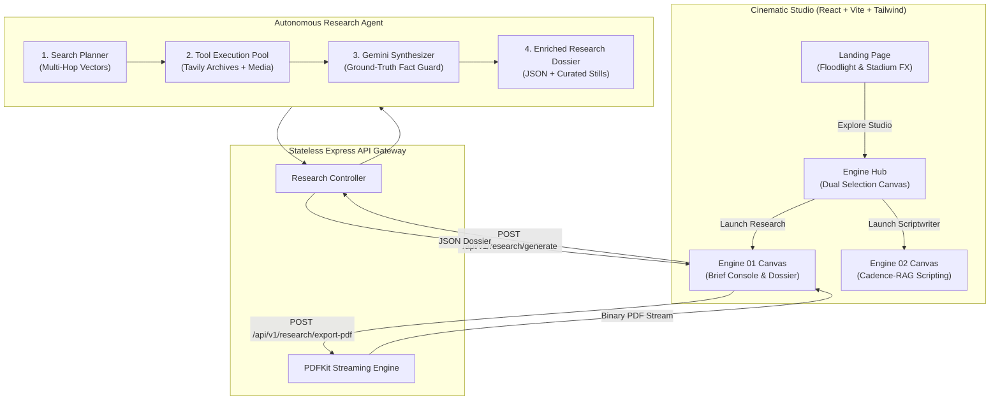

# 🏏 CricScript AI

<p align="center">
  
</p>

<p align="center">
  <strong>Autonomous Cricket Documentary Research & Cinematic Scriptwriting Studio</strong>
</p>

<p align="center">
  <a href="#-architecture"></a>
  <a href="#-tech-stack"></a>
  <a href="#-tech-stack"></a>
  <a href="#-tech-stack"></a>
  <a href="#-license"></a>
</p>

---

## 📽️ The Vision

Documentary cricket scripting requires granular, ground-truth facts:
- The psychology behind a 19th over
- Obscure MCC Laws cited by umpires
- Pre-tournament media criticisms and player form
- Verbatim press conference quotes and locker-room testimonies

**CricScript AI** turns hours of manual archive digging into a seconds-long autonomous research workflow. Built with a **stateless, pair-engine design**, it investigates historical cricket moments, compiles a verified dossier with archival stills and sources, and streams a print-ready, high-contrast PDF.

---

## 🏛️ System Architecture



---

## ✨ Flagship Capabilities

### 1. 🔍 Autonomous Multi-Hop Cricket Investigation
The agent doesn't execute a single basic search query. It plans and executes targeted searches in parallel:
- **General Match Overview**: Scorecards, context, and official match reports.
- **Statistical Anomalies**: Deep numbers via Cricinfo & HowStat archives.
- **Locker Room Statements**: Verbatim press-conference quotes & captain post-match interviews.
- **Venue & Tactics**: Pitch conditions, reverse swing factors, and bowling plans.
- **Director's Angles**: Dynamic searches prioritizing up to 5 user-provided focus points.

### 2. 📸 Curated Match Photography & Visual Archives
- Toggle **Include Photos & Links** to pull high-res archival stills directly from news photography and match coverage.
- Built-in photo cards with 1-click **View Full Resolution** and **Copy Direct Image URL** actions.
- Automatic fallback protection preventing broken image placeholders.

### 3. 🛡️ Strict Fact Grounding (Zero Hallucination)
- Temperature locked at `0.2` with strict JSON schema adherence.
- Gemini is forbidden from inventing stats, scores, or quotes. Every quote and turning point is anchored directly to retrieved search data.
- Progressive JSON repair fallback preventing truncation errors during large research queries.

### 4. 📄 High-Contrast Editorial PDF Generator
- Clean, crisp dark typography on an ultra-white canvas with Lord's/MCG turf-green (`#064E3B`) and leather-amber (`#B45309`) accents.
- Dynamic multi-page pagination (`Page X of Y`).
- Real clickable hyperlinks in the PDF for both news articles and high-res photo archives.
- Direct memory-buffered stream (`PDFDocument`) — 0 temporary files saved to disk.

### 5. 🪙 Token Budget Conscious
- Built-in word length slider (`100` to `1000` words) to conserve LLM tokens.
- Media toggle allows pure text-only research runs for ultra-fast generation.
- Search snippets trimmed before synthesis to maximize model context efficiency.

---

## 🛠️ Tech Stack

### Frontend
- **Framework**: React 18 + Vite (Production build in < 1 second)
- **Styling**: Tailwind CSS with custom Bebas Neue & Plus Jakarta Sans typography
- **Motion & UX**: Framer Motion transitions with sticky consoles and live radar progress
- **State**: Zustand (in-memory, ephemeral, 100% stateless)
- **Icons**: Lucide React

### Backend
- **Runtime**: Node.js (v22+) + Express.js
- **Intelligence**: Google Gemini API via official `@google/genai` SDK (`gemini-3.1-flash-lite`, `gemini-3.5-flash`)
- **Search Tooling**: Tavily Search API with image and description indexing
- **PDF Engine**: PDFKit with custom tabular layouts and hyperlinked footnotes
- **Security**: Helmet, CORS, and centralized error handling middleware

---

## 📂 Project Structure

```
CricPitch/
├── backend/
│   ├── server.js                          # Express app entry & middleware setup
│   ├── .env.example                       # Environment keys template
│   ├── controllers/
│   │   └── research.controller.js         # HTTP orchestration & PDF streaming
│   ├── routes/
│   │   └── research.routes.js             # Route endpoints
│   ├── middleware/
│   │   └── errorHandler.js                # Centralized error handler
│   ├── utils/
│   │   └── AppError.js                    # Operational error helper
│   ├── services/
│   │   └── pdf.service.js                 # Editorial PDF generation engine
│   └── researchAgent/
│       ├── agent.js                       # Autonomous research planner & orchestrator
│       ├── tools/
│       │   ├── webSearch.tool.js          # Tavily search integration (with image crawler)
│       │   ├── cricketStats.tool.js       # Specialized cricket stats tool
│       │   └── toolRegistry.js            # Extensible agent tool registry
│       ├── prompts/
│       │   └── researchSynthesizer.prompt.js # Grounding rules & JSON schema
│       └── llm/
│           └── gemini.client.js           # Multi-model fallback with JSON repair
│
└── frontend/
    ├── index.html                         # Entry HTML with custom cricket SVG favicon
    ├── src/
    │   ├── main.jsx                       # React root
    │   ├── App.jsx                        # State-machine page navigation
    │   ├── index.css                      # Custom theme, scrollbars & liquid glass CSS
    │   ├── store/
    │   │   └── useResearchStore.js        # Ephemeral Zustand research store
    │   ├── services/
    │   │   └── api.js                     # Axios client for research & PDF blob download
    │   └── views/
    │       ├── LandingView.jsx            # Cinematic landing page with stadium lighting
    │       ├── EngineHubView.jsx          # Interactive dual-engine studio hub
    │       ├── ResearchWorkspaceView.jsx  # Engine 01 deep research console & canvas
    │       └── ScriptWorkspaceView.jsx    # Engine 02 Cadence-RAG workspace (Milestone 3)
```

---

## 🚀 Quick Start Guide

### Prerequisites
- [Node.js](https://nodejs.org/) v20+ or v22+
- A free [Google Gemini API Key](https://aistudio.google.com/apikey)
- A free [Tavily Search API Key](https://tavily.com) (1,000 free searches/month)

---

### Step 1: Clone the Repository

```bash
git clone https://github.com/YOUR_USERNAME/CricPitch.git
cd CricPitch
```

---

### Step 2: Configure Backend

```bash
cd backend
npm install
```

Create a `.env` file inside `backend/`:

```env
PORT=5000
FRONTEND_URL=http://localhost:5173
GEMINI_API_KEY=your_gemini_api_key_here
TAVILY_API_KEY=your_tavily_api_key_here
```

Start the development server:

```bash
npm run dev
```

The backend starts at `http://localhost:5000`.

---

### Step 3: Configure Frontend

Open a second terminal window:

```bash
cd frontend
npm install
npm run dev
```

The frontend studio launches at `http://localhost:5173`.

---

## 📡 API Reference

### 1. Generate Research Dossier
- **URL**: `/api/v1/research/generate`
- **Method**: `POST`
- **Payload**:
  ```json
  {
    "topic": "Virat Kohli 82* vs Pakistan MCG 2022",
    "preContext": [
      "Two sixes off Haris Rauf in the 19th over",
      "Pre-tournament form critics",
      "90,000 MCG crowd noise"
    ],
    "researchLength": 500,
    "includeMedia": true
  }
  ```
- **Response**:
  ```json
  {
    "success": true,
    "data": {
      "dossier": {
        "topic": "Virat Kohli 82* vs Pakistan MCG 2022",
        "generatedAt": "2026-10-25T14:30:00.000Z",
        "collectedImages": [
          {
            "url": "https://example.com/kohli-mcg.jpg",
            "title": "Virat Kohli celebration after winning shot at MCG"
          }
        ],
        "synthesizedReport": {
          "executiveSummary": "...",
          "preMatchContext": [...],
          "keyChronology": [...],
          "tacticalBreakdown": [...],
          "verifiedQuotes": [...],
          "statHighlights": [...],
          "sources": [...]
        }
      }
    }
  }
  ```

---

### 2. Export Dossier as PDF
- **URL**: `/api/v1/research/export-pdf`
- **Method**: `POST`
- **Payload**: `{ "dossier": { ... } }`
- **Response**: Streamed `application/pdf` binary download.

---

## 🗺️ Roadmap & Milestones

- [x] **Milestone 1 — Core Foundation**: Express architecture, Google GenAI SDK, and Tavily multi-hop planning.
- [x] **Milestone 2 — Deep Research Agent**: Fact grounding, media crawler, visual archives grid, and PDF export.
- [ ] **Milestone 3 — Cadence-RAG Engine**: Upload reference scripts (PDF/TXT) to mimic your unique cadence, narrative pacing, and sentence rhythm.
- [ ] **Milestone 4 — Timeline Editor**: Drag-and-drop scene breakdown with B-roll audio cue suggestions.

---

## 📄 License

MIT License. Crafted for cricket enthusiasts, analysts, and documentary filmmakers worldwide.
