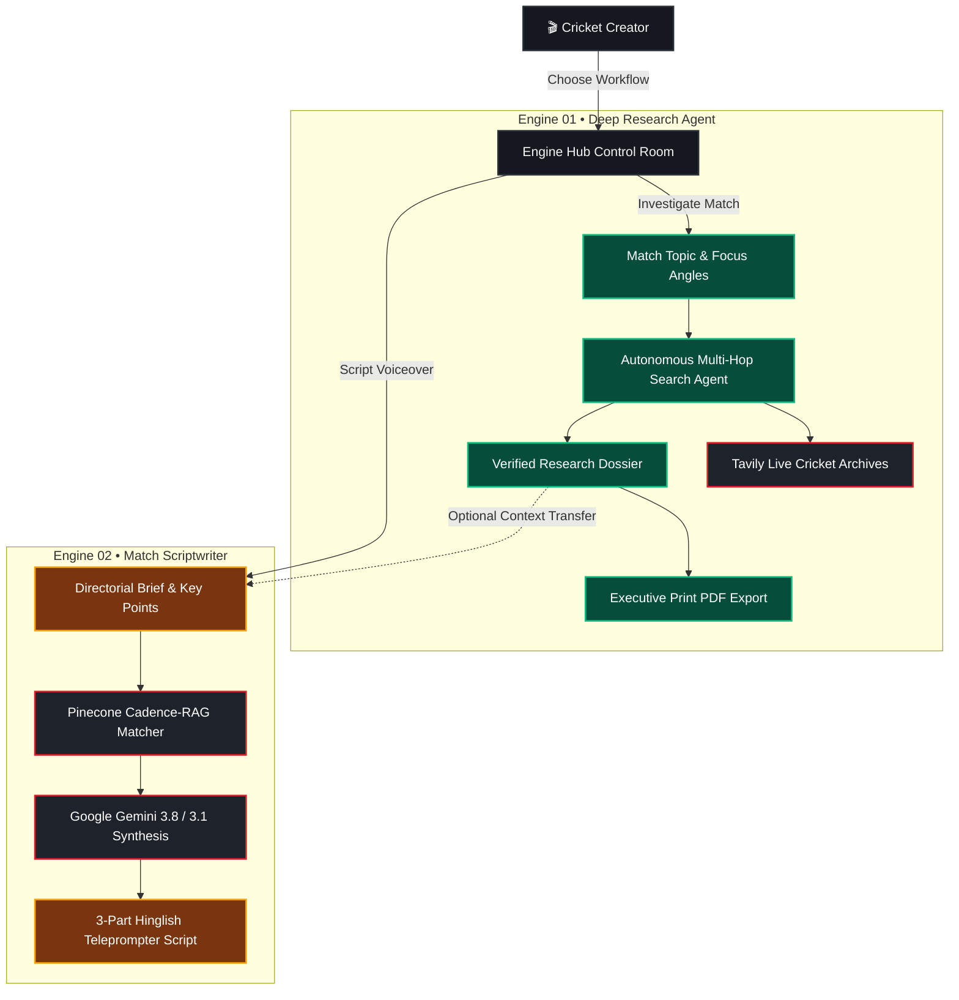

<div align="center">

  

  # 🏏 CricScript AI
  ### Autonomous Cricket Documentary Research & Cadence Scriptwriting Studio

  **Stateless • Zero Hallucination • Cadence-Matched Hinglish • True 4K Sports Engine**

  <br />

  [](.github/workflows/ci.yml)
  [](#-security--privacy-posture)
  [](#-architectural-topology)
  [](https://nodejs.org)
  [](https://react.dev)
  [](https://tailwindcss.com)

  <br />

  [Explore Engine Hub](#-the-dual-engine-pipeline) • [Security & Privacy](#-security--privacy-posture) • [Quickstart](#-quickstart-guide) • [API Specs](#-api-specification) • [Deployment](#-cloud-deployment)

</div>

---

## 📽️ Why CricScript AI?

Creating viral, high-retention cricket documentaries requires two pillars that generic LLM chatbots fail to deliver:

1. **Unassailable Ground-Truth Facts:** Exact ball-by-ball chronologies, reverse-swing physics, pitch deterioration, DRS controversy nuances, locker-room quotes, and high-resolution match photography.
2. **Authentic Narrative Cadence:** High-tension pacing, dramatic `[pause]` acoustic cues, and conversational Hinglish storytelling calibrated under 1,000 words to maximize YouTube and social video retention.

| Feature Dimension | Generic AI Chatbots (ChatGPT / Claude) | 🏏 CricScript AI Studio |
| :--- | :--- | :--- |
| **Fact Grounding** | Prone to match hallucinations & invented scores | **100% Grounded via Multi-Hop Scorecard Research** |
| **Pacing & Cadence** | Flat, robotic, essay-style English paragraphs | **3-Part Hinglish with `[pause]` Acoustic Markers** |
| **Match Context** | Superficial score highlights | **Deep Pitch Dynamics, Reverse-Swing & Quotes** |
| **Retention Budget** | Uncontrolled word length | **Strict Discipline Under 1,000 Words (~7 mins)** |
| **Export Formats** | Plain unformatted markdown | **Executive Print-Ready PDF + Live Teleprompter** |
| **Privacy & Auth** | Forced accounts, telemetry & data logging | **100% Anonymous & Stateless (Zero Identity)** |

---

## 🏛️ The Dual-Engine Pipeline



### 🔍 Engine 01 — Deep Investigative Research Agent
- **Autonomous Multi-Hop Research:** Deploys targeted investigative passes across official scorecards, commentary feeds, and press conference transcripts.
- **Context Extraction:** Surface pitch condition changes, bowler fatigue arcs, critical tactical turning points, and post-match player statements.
- **Editorial PDF Engine:** Zero-disk streaming compilation generating clean, high-contrast, broadcast-ready PDF dossier reports via `PDFKit`.

### 🎙️ Engine 02 — Hinglish Cadence Scriptwriter
- **Cadence-RAG Architecture:** Leverages semantic vector search to retrieve exemplar voiceover chunks, transferring genuine conversational rhythm.
- **3-Part Narrative Arc:** Structures scripts into:
  - `PART 1: INTRO` — High-stakes hook, historical context, and the psychological setting.
  - `PART 2: MAIN` — Ball-by-ball tactical escalation, pressure spikes, and commentary banter.
  - `PART 3: OUTRO` — The climax, historical legacy, and reflective creator sign-off.
- **Teleprompter Acoustic Markers:** Automatically inserts `[pause]` cues so crowd roar, stadium ambience, and dramatic pauses breathe through.

---

## 🎨 Visual Identity & Color System

Designed with a modern sports-technology aesthetic inspired by floodlit international stadiums at night:

| Color Token | Hex Code | Visual Application | Swatch |
| :--- | :--- | :--- | :--- |
| `--bg-app` | `#08090B` | Deep stadium night foundation | `■` `#08090B` |
| `--bg-card` | `#15191F` | Matte carbon card surfaces | `■` `#15191F` |
| `--bg-surface-elevated` | `#1B2028` | Elevated modals, buttons & popovers | `■` `#1B2028` |
| `--border-medium` | `#292F38` | Structural dividing borders | `■` `#292F38` |
| `--accent-primary` | `#D91F2B` | Brand Crimson (Primary CTAs, status beacons) | `■` `#D91F2B` |
| `--accent-emerald` | `#10B981` | Grounded Research & Fact-Verification badges | `■` `#10B981` |
| `--accent-amber` | `#F59E0B` | Scriptwriting Cadence & Voiceover badges | `■` `#F59E0B` |
| `--text-primary` | `#F5F5F5` | High-contrast broadcast typography | `■` `#F5F5F5` |

> [!NOTE]
> Includes verified genuine **3840 × 2160 (16:9 True 4K)** stadium photography of the Melbourne Cricket Ground (MCG) and Barsapara Stadium under floodlights with automated WebP compression and JPEG fallbacks.

---

## 🔒 Security & Privacy Posture

CricScript AI is built with an uncompromising commitment to **zero-identity, anonymous, and stateless architecture**:

- **No User Accounts:** No sign-up, login, passwords, email capture, or database records containing personal identities.
- **No Tracking Cookies:** **0 HTTP session cookies**, **0 advertising pixels**, and **0 tracking cookies**. Browser storage is used solely for local theme preference (`cricscript-theme`).
- **OWASP Hardened Input Boundaries:**
  - Strict schema validation on all inputs ([`validator.js`](backend/middleware/validator.js)).
  - Automatic string length caps (Topics: 3–300 chars, Key Points: max 10 items ≤ 350 chars).
  - Recursive prototype pollution rejection (`__proto__`, `constructor`, `prototype`).
  - Request body limits strictly capped at `150kb`.
- **Zero-SSRF Guarantee:** The backend never downloads arbitrary user-provided URLs. PDF image references are rendered as client-side text hyperlinks without server-side fetching.
- **Tiered Public Rate Limiting:**
  - `Global API`: 120 requests / 15 minutes per IP.
  - `AI Synthesis`: 15 generations / 15 minutes per IP.
  - `PDF Export`: 30 compilations / 15 minutes per IP.
- **Security Headers Active:** `X-Content-Type-Options: nosniff`, `X-Frame-Options: DENY`, `Referrer-Policy: strict-origin-when-cross-origin`, and Content Security Policy (CSP).

---

## ⚡ Quickstart Guide

### Prerequisites
- **Node.js:** v20.x or higher
- **npm:** v10.x or higher
- **API Keys:** Google Gemini API key ([Google AI Studio](https://aistudio.google.com/apikey)) and Tavily Search key ([Tavily](https://tavily.com)).

### 1. Clone & Environment Setup
```bash
git clone https://github.com/your-org/cricpitch.git
cd cricpitch

# Copy backend environment template
cp backend/.env.example backend/.env
```

Edit `backend/.env` with your API keys:
```env
PORT=5000
NODE_ENV=development
GEMINI_API_KEY=your_gemini_api_key_here
TAVILY_API_KEY=your_tavily_api_key_here
FRONTEND_URL=http://localhost:5173
```

### 2. Install Dependencies
```bash
# Install backend dependencies
npm --prefix backend install

# Install frontend dependencies
npm --prefix frontend install
```

### 3. Launch Development Servers
```bash
# Terminal 1: Backend Gateway (http://localhost:5000)
npm --prefix backend run dev

# Terminal 2: Frontend Studio (http://localhost:5173)
npm --prefix frontend run dev
```

---

## 🌐 API Specification

All endpoints are mounted under `/api/v1` and return structured JSON:

```
GET  /api/v1/health            → Liveness probe (uptime, status, timestamp)
GET  /api/v1/ready             → Readiness probe (upstream provider checks)
POST /api/v1/research/generate → Multi-hop cricket archive investigation
POST /api/v1/research/export-pdf → Compile & stream executive brief PDF
POST /api/v1/scripts/generate  → Synthesize 3-part Hinglish cadence script
```

### Example: Script Generation Request
```bash
curl -X POST http://localhost:5000/api/v1/scripts/generate \
  -H "Content-Type: application/json" \
  -d '{
    "topic": "Virat Kohli 82* vs Pakistan Melbourne 2022",
    "keyPoints": [
      "India 31/4 collapse against Shaheen and Haris Rauf",
      "Partnership with Hardik Pandya steadying the ship",
      "The 19th over straight six off Rauf",
      "Chaotic 20th over finish off Nawaz"
    ]
  }'
```

---

## 🧪 Quality Assurance & Verification

Execute the pre-production test suite:

```bash
# 1. Backend syntax self-check
node --check backend/server.js

# 2. Frontend lint analysis (Oxlint)
npm --prefix frontend run lint

# 3. Production bundle compilation
npm --prefix frontend run build

# 4. Dependency security audit
npm --prefix backend audit --audit-level=high
npm --prefix frontend audit --audit-level=high
```

---

## 🚀 Cloud Deployment

CricScript AI is pre-configured for continuous deployment:

```
[ Git Repository ]
       │
       ├─── Push to main ───► [ Vercel ]  ──► Deploys Frontend SPA (dist)
       │
       └─── Push to main ───► [ Render ]  ──► Deploys Stateless Express API
```

- **Frontend on Vercel:** Handled via [`frontend/vercel.json`](frontend/vercel.json) with client-side SPA routing, immutable caching (`max-age=31536000`), and production Content-Security-Policy headers.
- **Backend on Render:** Handled via [`render.yaml`](render.yaml) blueprint with automatic zero-downtime health checking on `/api/v1/health` and graceful `SIGTERM` container shutdown.

> For complete step-by-step instructions, see [`DEPLOYMENT.md`](DEPLOYMENT.md).

---

## 📑 Documentation Index

- [`DEPLOYMENT.md`](DEPLOYMENT.md) — Complete Vercel & Render production deployment guide.
- [`SECURITY.md`](SECURITY.md) — Threat model, OWASP controls, and vulnerability reporting.
- [`INCIDENT_RESPONSE.md`](INCIDENT_RESPONSE.md) — Operational runbook for outages, rate limits, and key rotations.
- [`frontend/src/views/PrivacyPolicyView.jsx`](frontend/src/views/PrivacyPolicyView.jsx) — Production Privacy Policy page (`/privacy`).
- [`frontend/src/views/TermsView.jsx`](frontend/src/views/TermsView.jsx) — Production Terms & Conditions page (`/terms`).

---

<div align="center">
  <sub>Built with precision for cricket creators. Zero fluff • Stateless • 100% Fact-Grounded.</sub>
</div>
