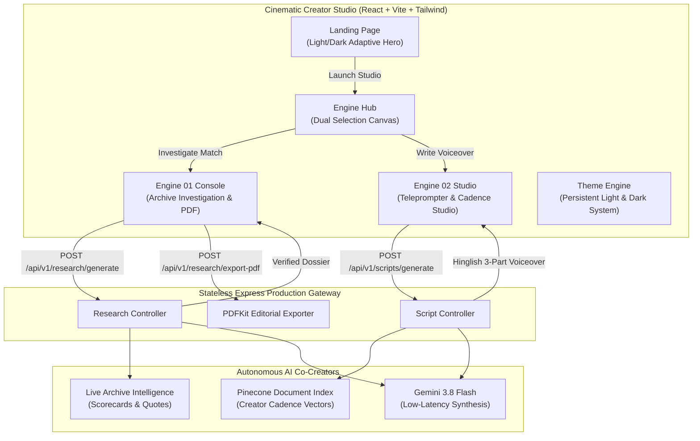

# 🏏 CricPitch (CricScript AI)

<p align="center">
  
</p>

<p align="center">
  <strong>Autonomous Cricket Investigative Research & High-Retention Voiceover Studio</strong>
</p>

<p align="center">
  <a href="#-dual-engine-architecture"></a>
  <a href="#-engine-01-investigative-research-agent"></a>
  <a href="#-engine-02-creator-voiceover-studio"></a>
  <a href="#-theme-system"></a>
  <a href="#-strict-script-privacy--security"></a>
</p>

---

## 📽️ The Creative Vision

Creating high-retention cricket documentary videos requires two critical pillars that generic tools fail to deliver:
1. **Unassailable Ground-Truth Facts:** Exact ball-by-ball chronologies, pitch dynamics, reverse-swing conditions, obscure MCC laws, locker-room quotes, and high-resolution match photography.
2. **Authentic Narrative Voice:** The creator's signature pacing, staccato tension, dramatic `[pause]` acoustic cues, and conversational Hinglish storytelling that keeps viewers glued to the screen.

**CricPitch** solves both problems with an autonomous, dual-engine creator studio:
- **Engine 01 (Investigative Research Agent):** Digs through official match archives, scorecards, and press conferences under strict zero-hallucination fact grounding, compiling an executive brief with downloadable editorial PDF reports.
- **Engine 02 (Voiceover Studio & Cadence Engine):** Calibrates to your personal storytelling cadence by referencing your authentic scripts, generating 3-part teleprompter voiceover copy (Intro • Main • Outro) strictly under 1,000 words.

---

## 🏛️ Dual-Engine Architecture



---

## ✨ Production Capabilities

### 🔍 Engine 01 — Deep Archive Investigation
- **Multi-Hop Search Planning:** Automatically executes targeted queries across official scorecards, commentary archives, and press conferences.
- **Strict Zero-Hallucination Fact Guarding:** Temperature locked at `0.2`. Every turning point, score, and quote is anchored directly to verified match data.
- **Visual Match Archives:** Surfaces high-resolution documentary stills and original source links with one-click full-resolution previews.
- **High-Contrast Editorial PDF Export:** Generates clean, publication-grade print dossiers with hyperlinked footnotes and chronological timeline cards.

### 🎙️ Engine 02 — Personal Voiceover Studio
- **Creator Script Vault:** Houses your authentic scripts, classified into narrative blocks (Hooks, Turning Points, Tactical Breakdowns, Climax).
- **Acoustic Breath Markers:** Enforces staccato phrasing and `[pause]` acoustic cues tailored for natural voiceover delivery.
- **Disciplined 3-Part Teleprompter Architecture:**
  - **Part 1 (The Hook & Stakes):** Captures the viewer in the first 10 seconds (~180–220 words).
  - **Part 2 (The Tactical Battle):** Psychological duel, momentum shifts, and ball-by-ball tension (~550–650 words).
  - **Part 3 (Emotional Payoff & Legacy):** Final roar, historical fallout, and lingering philosophical reflection (~150–200 words).
- **Strict Length Cap:** Disciplined under 1,000 words for optimal YouTube retention.
- **Animated Lazy-Loading Visualizer:** Shimmering teleprompter skeletons with real-time acoustic waveform animations while generating.

### 🎨 Semantic Light & Dark Theme System
- **100% Adaptive UI:** Zero hardcoded colors or locked dark-only utility classes.
- **Light Mode:** Crisp, luminous pearl surfaces, high-contrast deep ink typography, and radiant emerald highlights.
- **Dark Mode:** Deep midnight obsidian surfaces, subtle emerald/amber ambient glows, and velvet card elevations.
- **Persistent Toggle:** Remembers your preference across sessions via `localStorage`.

---

## 🔒 Strict Script Privacy & Security

Your writing voice is your intellectual property. CricPitch enforces strict security standards:
- **Repository Isolation:** All private scripts, raw docs, extracted text, and processed chunks in `backend/data/` are strictly ignored via `.gitignore`.
- **Zero Drive Modifications:** Cloud imports operate exclusively through read-only exports (`gdrive readonly export`). Antigravity and the backend never modify, delete, or overwrite your cloud files.
- **Private Integrated Vectors:** Cadence exemplars are indexed in your private Pinecone namespace, with local fallback for 100% uptime.

---

## 🛠️ Tech Stack

### Frontend
- **Framework:** React 18 + Vite (Production build in ~1.2s)
- **Styling:** Tailwind CSS with semantic CSS variables and Bebas Neue, Space Grotesk, and Plus Jakarta Sans typography
- **State Management:** Zustand (in-memory, ephemeral, zero auth clutter)
- **Animations:** Framer Motion + custom CSS shimmer and audio waveform equalizers
- **Icons:** Lucide React

### Backend
- **Runtime:** Node.js (v20+ / v22+) + Express.js
- **Model Engine:** Google Gemini API via official `@google/genai` SDK (`gemini-3.8-flash`)
- **Search Tooling:** Tavily Search API with image and description indexing
- **Vector Retrieval:** Pinecone Vector Database (`@pinecone-database/pinecone`) with integrated inference
- **Document Extractors:** `mammoth` (DOCX), `adm-zip` (bulk archives), `pdf-parse`
- **PDF Engine:** PDFKit streaming engine
- **Security:** Helmet, CORS, and centralized error handling middleware

---

## 🚀 Quick Start Guide

### Prerequisites
- [Node.js](https://nodejs.org/) v20+ or v22+
- A [Google Gemini API Key](https://aistudio.google.com/apikey)
- A [Tavily Search API Key](https://tavily.com)
- *(Optional)* A [Pinecone API Key](https://www.pinecone.io/) for cloud vector retrieval (local fallback is included automatically)

---

### Step 1: Clone the Repository

```bash
git clone https://github.com/YOUR_USERNAME/CricPitch.git
cd CricPitch
```

---

### Step 2: Configure & Start Backend

```bash
cd backend
npm install
```

Create `.env` inside `backend/`:

```env
PORT=5000
FRONTEND_URL=http://localhost:5173
GEMINI_API_KEY=your_gemini_api_key_here
TAVILY_API_KEY=your_tavily_api_key_here
PINECONE_API_KEY=your_pinecone_api_key_here
PINECONE_INDEX_NAME=cricscript-rag
```

Launch development server:

```bash
npm run dev
```

The backend starts at `http://localhost:5000`.

---

### Step 3: Configure & Start Frontend

Open a new terminal window:

```bash
cd frontend
npm install
npm run dev
```

The frontend launches at `http://localhost:5173`.

---

## 📡 API Reference

### 1. Research Engine
- `POST /api/v1/research/generate` — Autonomous multi-hop match archive investigation.
- `POST /api/v1/research/export-pdf` — Streams publication-grade editorial PDF report.

### 2. Voiceover Studio & Cadence Engine
- `POST /api/v1/scripts/generate` — Synthesizes 3-part Hinglish script under 1,000 words with dramatic acoustic `[pause]` cues.

---

## 📄 License

MIT License. Crafted for cricket analysts, documentarians, and digital storytellers worldwide.
